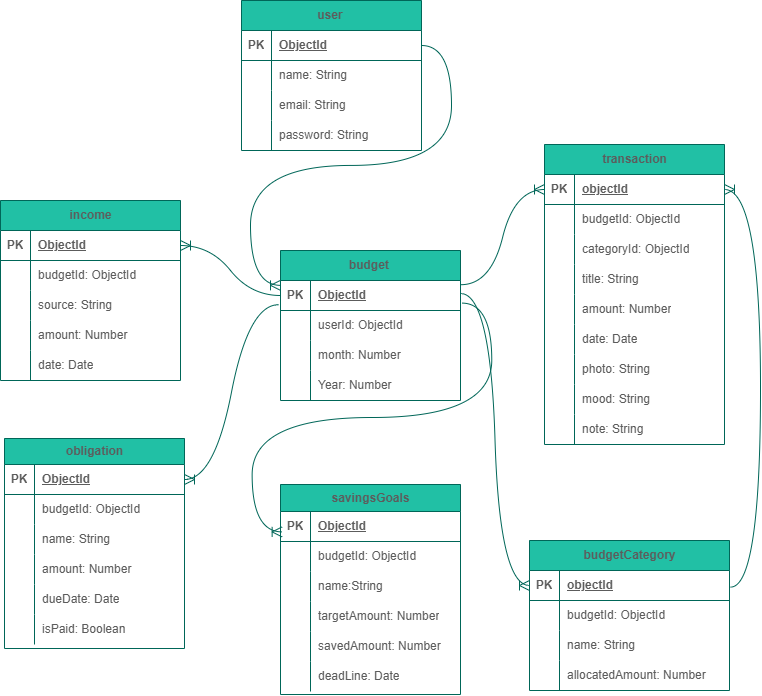

## Project name 

Money Diary 

## Overview 

Money Diary is a personal finance management web application that helps users organize and manage their financial lives.

Users can record their monthly salary and additional income, track their financial obligations, calculate their remaining balance, and divide their money into different budget categories.

The application also includes a personal spending journal where users can record their purchases, upload photos, write personal notes, and describe how they felt about each purchase.

Money Diary aims to help users understand their spending habits, manage their budgets, and achieve their financial goals.

## Technologies used 

1. HTML 
2. CSS
3. JavaScript 
4. EJS
5. Node.js
6. Express.js
7. MongoDB
8. Mongoose

## Getting Started

### Steps to Clone the Template

1. Create a folder for your project and navigate into it:

   ```bash
   mkdir money-diary
   cd money-diary
   ```

2. Clone the authentication template:

   ```bash
   git clone https://github.com/SEB-16-Bahrain/auth-template.git .
   ```

3. Remove the template's Git history and README file:

   ```bash
   rm -rf .git
   rm README.md
   ```

4. Create a `.env` file in the root directory and add the following environment variables:

   ```env
   MONGODB_URI=your-mongo-db-connection-string
   SESSION_SECRET=your-secret-key
   PORT=3000
   ```

5. Install dependencies:

   ```bash
   npm i
   ```

## User Stories 

1. As a user, I want to create an account and log in so that I can manage my personal financial information.

2. As a user, I want to add my monthly salary and additional income so that I can keep track of all the money I receive.

3. As a user, I want to add, edit, and delete my monthly financial obligations so that I can manage my fixed expenses.

4. As a user, I want to see my total income, total obligations, and remaining balance so that I know how much money I have available.

5. As a user, I want to divide my remaining money into customizable budget categories so that I can plan how to spend and save my money.

6. As a user, I want to create, edit, and delete savings goals so that I can track my progress toward achieving them.

7. As a user, I want to record my purchases with photos, personal notes, and moods so that I can keep a personal diary of my spending experiences.

8. As a user, I want to view a monthly financial summary so that I can review my expenses, savings, and spending habits.

## Database Design

The application uses MongoDB as its database and Mongoose to define and manage the database models.

The database consists of seven main models:

1. User: Stores user account information such as name, email, and password.

2. Budget: Stores monthly budget information and is connected to a user.

3. Income: Stores monthly salary and additional income records.

4. Obligation: Stores monthly financial commitments such as bills, installments, and subscriptions.

5. BudgetCategory: Stores budget categories and their allocated amounts.

6. Transaction: Stores purchases, expenses, photos, moods, and personal notes.

7. SavingsGoal: Stores savings goals, target amounts, saved amounts, and deadlines.



## Routes

### Budget Routes

| Method | Route | Description |
|---|---|---|
| GET | `/budget/new` | New budget form |
| POST | `/budget` | Create a new budget |
| GET | `/budget` | Display all budgets |
| GET | `/budget/:id` | View budget details |
| GET | `/budget/:id/edit` | Edit budget form |
| PUT | `/budget/:id` | Update budget |
| DELETE | `/budget/:id` | Delete a budget |

### Income Routes

| Method | Route | Description |
|---|---|---|
| GET | `/income/budget/:budgetId/new` | New income form |
| POST | `/income/budget/:budgetId` | Create income |
| GET | `/income/budget/:budgetId` | Display all income for a budget |
| GET | `/income/:id/edit` | Edit income form |
| PUT | `/income/:id` | Update income |
| DELETE | `/income/:id` | Delete income |

### Obligation Routes

| Method | Route | Description |
|---|---|---|
| GET | `/obligation/budget/:budgetId/new` | New obligation form |
| POST | `/obligation/budget/:budgetId` | Create obligation |
| GET | `/obligation/budget/:budgetId` | Display all obligations for a budget |
| GET | `/obligation/:id/edit` | Edit obligation form |
| PUT | `/obligation/:id` | Update obligation |
| PUT | `/obligation/:id/status` | Mark obligation as paid or unpaid |
| DELETE | `/obligation/:id` | Delete obligation |

### Budget Category Routes

| Method | Route | Description |
|---|---|---|
| GET | `/budget-category/budget/:budgetId/new` | New category form |
| POST | `/budget-category/budget/:budgetId` | Create category |
| GET | `/budget-category/budget/:budgetId` | Display all categories for a budget |
| GET | `/budget-category/:id/edit` | Edit category form |
| PUT | `/budget-category/:id` | Update category |
| DELETE | `/budget-category/:id` | Delete category |

## Features

- User registration and authentication.

- Monthly salary and additional income management.

- Monthly financial obligations tracking.

- Automatic remaining balance calculation.

- Customizable budget categories.

- Expense and purchase tracking.

- Upload photos of purchased items.

- Personal spending notes and mood tracking.

- Savings goals and progress tracking.

- Monthly financial summaries.

- CRUD operations for financial records.

## Future Enhancements

## Credits

## Screenshots
